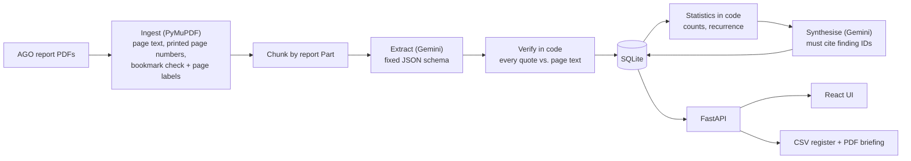

# IT Audit Insights: AI analysis of AGO annual reports

A full-stack prototype that reads Reports of the Auditor-General (AGO) of Singapore and turns them into an evidence-backed view of **IT control and technology-risk findings** across years: what keeps failing, where, how seriously, and what auditors should look at next.

Every finding links to the exact sentence and page in the source PDF, and that quote is checked by code before the finding is trusted.

  

---

## Quick start

**No API key is needed to explore the app.** Results from the bundled reports are committed and load automatically on first start.

Prerequisites: [uv](https://docs.astral.sh/uv/) (Python 3.11+) and Node.js 20+.

```bash
# 1. Backend API (http://localhost:8000)
cd backend
uv sync
uv run uvicorn app.api:app --port 8000
```

```bash
# 2. Frontend (http://localhost:5173), in a second terminal
cd frontend
npm install
npm run dev
```

Open http://localhost:5173.

### Processing new reports (needs your own Gemini API key)

Uploading a report, re-running a report and regenerating the briefing call the **Gemini API**, so a Gemini API key is required for these. I have not included one.

The committed results were produced on a **paid (billing-enabled) Gemini API key**, which is what I recommend for re-running: it has much higher rate limits, and a full run of the four reports costs roughly $0.10–1 depending on the model. A **free-tier key may also work**, but it has low per-minute and daily limits, so runs are slower and can stop part-way. Re-running the same command resumes where it stopped, because finished sections are cached.

1. Get a key at https://aistudio.google.com/apikey. For the paid tier, enable billing on the key's Google Cloud project (and set a budget alert).
2. `cp backend/.env.example backend/.env` and paste the key into `GEMINI_API_KEY`.
3. On the **free tier**, also set `GEMINI_MIN_INTERVAL=12` to stay under its per-minute quota.
4. Restart the API, then upload PDFs on the **Reports** page, or process everything in `data/reports/` from the command line:

```bash
cd backend
uv run python -m app.pipeline              # ingest, extract, synthesise, export
uv run python -m app.pipeline --reprocess  # re-extract reports already processed
uv run python -m eval.evaluate             # score extraction against the hand-labelled set
```

Without a key the app detects this and turns off upload, re-run and regenerate, with a short note pointing here. Everything else works on the pre-computed results.

### Tests

```bash
cd backend && uv run pytest -q     # 30 tests: ingestion, verification, dedupe, LLM retries, exports, API + worker
cd frontend && npm test            # interaction tests: filtering, opening evidence, needs-review flow
```

---

## What it does

| Page | For the auditor |
|---|---|
| **Overview** | Headline numbers; a control-area × year heatmap with recurring areas marked; severity by year; most affected entities, the IT systems involved, and the policies AGO cited most often. Every number opens the underlying findings. |
| **Insights** | A cross-report briefing: executive summary, focus areas for the next audit cycle (by priority), themes with recommendations and suggested audit procedures, recurring issues and key insights. Each point cites its source findings. **Download as PDF.** |
| **Findings** | A searchable register (filter by year, entity, control area, severity, evidence check). Opening a finding shows its details and **the report page rendered with the quote highlighted**. Export to CSV (Excel). |
| **Reports** | Upload PDFs (up to 10 at a time), live processing status, re-run, delete, open the source PDF. |

---

## Tech stack and architecture



| Layer | Choice | Why |
|---|---|---|
| Language (backend) | **Python 3.11+** | Best ecosystem for PDF processing and LLM SDKs. |
| API | **FastAPI** + Pydantic v2 | Typed endpoints; the same Pydantic models define the LLM's output schema, the database records and the API responses. |
| PDF | **PyMuPDF** | One library for text, bookmarks, word positions (for highlighting), page rendering and PDF generation. Fast, no system dependencies. |
| LLM | **Gemini** via `google-genai` (default `gemini-3.5-flash-lite`) | Enforces a JSON schema natively, long context, low cost. See *AI approach*. |
| Fuzzy matching | **RapidFuzz** | Verifies quotes against page text despite line breaks and hyphenation. |
| Storage | **SQLite** (one file) + PDFs on disk | Any number of reports, per-report status, duplicate detection and filtering, with no server to run. |
| Background jobs | One worker thread | Reports are processed in order, which keeps within API rate limits; uploads return immediately. |
| Frontend | **React 19 + TypeScript + Vite**, **Tailwind CSS 4**, **TanStack Query**, **Recharts** | Typed, fast to build; TanStack Query polls live processing status. |
| Tests | **pytest**, **Vitest** + Testing Library | Backend logic and API; frontend interactions without a browser download. |

**Deliberately not used:** LangChain or agent frameworks (two well-specified prompts don't need an orchestration layer, and it would be one more thing to debug), a vector database (findings are structured records, not text to search semantically), and a separate database server.

### Repository layout

```
backend/
  app/
    ingest.py      PDF → pages with verified section labels
    extract.py     report → chunks → LLM → findings
    verify.py      quote verification against the PDF text
    insights.py    statistics (code) + cross-report synthesis (LLM)
    llm.py         provider interface, Gemini client, cache, retries, fallbacks
    db.py          SQLite store
    service.py     upload, dedupe, processing, seed/export
    worker.py      background job queue
    api.py         HTTP API
    export.py      CSV register and PDF briefing
    prompts/       extraction and synthesis prompts (versioned as files)
  eval/            hand-labelled gold set + evaluation script
  tests/
frontend/src/      pages, components, tests
data/
  reports/         source PDFs (public AGO reports)
  output/          committed results, loaded on first start
```

---

## Solution approach

**The problem:** an auditor reading several 100-page reports wants the IT findings, which are a small minority of the content and often buried inside sections about grants, payments or operations, and then the patterns across years and agencies. Anything the tool claims must be traceable to the source, or it can't go into audit work.

**The approach:** deterministic code wherever it is reliable, the LLM only where judgement is needed, and every LLM claim checked.

1. **Ingest (no AI).** Each page's text, its printed page number (what auditors cite) and its position in the report's bookmark tree (Part › Ministry › Agency › Observation). The bookmarks are not trusted blindly: each title is checked against the page text, and if it isn't there, the parent section is searched. **This corrected 3 bookmarks in FY2021/22** that pointed to another agency's pages. Each page then carries a label such as `[PDF page 34 | printed page 24 | section: PART I B > MINISTRY OF MANPOWER > …]`, so findings are attributed correctly even when a paragraph never names the agency.
2. **Extract (LLM).** One call per report Part (3–4 calls per report), returning findings in a fixed schema: entity, system, control area (from a fixed list of 11), what failed, key facts, root cause, risk, CIA impact, severity with rationale, policies breached, management response, and 1–3 verbatim quotes with page numbers.
3. **Verify (no AI).** Every quote is searched for on its cited page (and neighbours) with fuzzy matching. A finding is *traced to source* if all quotes are found, *partly verified* if some are, and *needs review* if none are. Unverified findings are excluded from counts and the briefing. Partly verified findings remain flagged for analyst review.
4. **Aggregate (no AI).** Counts by control area and year, entities, systems, policies, and which control areas recur across years. LLMs miscount; these numbers must be reproducible.
5. **Synthesise (LLM).** Themes, recurring issues, insights and focus areas, written from the verified findings and the computed statistics. Every item must cite finding IDs; IDs the model invents are dropped, and the years and entities shown for each theme are derived from the cited findings, not from the model.

**Uploads and duplicates.** Re-uploading the same file is detected by SHA-256. A re-saved copy with identical text is detected by per-page text fingerprints. A changed edition is accepted, with a warning naming the report it overlaps, so its findings aren't counted twice unknowingly.

---

## AI approach

### Model selection

- **Default: `gemini-3.5-flash-lite`, a deliberately low-cost model.** Extraction here is a closely specified, schema-bound task, and quality is protected by the schema, the code verification of every quote, and the evaluation set, not by the model alone.
- **It can be upgraded with one setting:** `GEMINI_MODEL=gemini-3.8-flash` (or `gemini-3.6-flash`) trades cost for quality, with no code change. The evaluation script shows whether the upgrade helps.
- **The committed results and the evaluation below were produced on the paid tier with the model name `gemini-3.5-flash`.** Google has deprecated that name and, since 8 October 2026, routes its requests to `gemini-3.6-flash`, so in practice they were served by Gemini 3.6 Flash. New runs should name a current model directly.
- **Fallbacks:** if the main model is overloaded or unavailable, calls step up to `gemini-3.6-flash`, then `gemini-3.8-flash`, so a temporary outage doesn't fail a run.
- **Why Gemini:** native JSON-schema output, long context, a free tier for prototyping and a low paid price. GPT and Claude models are equally capable for this task; the choice is about cost and setup, and the provider layer keeps it reversible.
- **Cost:** a full run (4 reports + briefing) is about 190k input tokens and 30–100k output tokens: roughly **$0.10–0.30 on Flash-Lite**, ~$1 on 3.6 or 3.8 Flash.

### Prompt design ([`prompts/`](backend/app/prompts))

- **Extraction prompt:** the role (experienced IT auditor); an explicit definition of what counts as an IT finding, including the buried forms (e.g. *"no system checks were put in place to validate…"* inside a grants observation) and what doesn't (manual procurement lapses, falsified documents unless a system control failed); granularity (one record per distinct failure, sub-sections A/B/C separate, no duplicates from the Overview); how to read the page labels for attribution; verbatim-only evidence rules; *facts only, null if not stated*; and a **severity rubric with concrete triggers** (harm actually occurred; unrestricted admin access with no monitoring; system-wide failure for a year or more), *"choose the lower level when unsure"*, and a rationale that must name the rule applied.
- **Synthesis prompt:** use only the findings provided, cite IDs for every claim, use the computed statistics rather than counting, be specific (agency, system, year), look for cross-report patterns a single-report reader would miss, and make audit procedures concrete tests.
- Temperature 0. Prompts are versioned files; the cache key includes the prompt, so changing a prompt re-runs only what it affects.

### Architecture decisions

| Decision | Alternative considered | Why |
|---|---|---|
| One call per report **Part** | Whole report in one call; one call per page | Whole reports (~50k tokens) risk missing small buried findings and give no reliable page citations; per-page calls lose context and cost far more. Parts are 10–40 pages, read closely in 3–4 calls. |
| **Structured output** (Pydantic schema enforced by the API) | Free-text summaries | Findings must be counted, filtered and compared across years. |
| **Fixed list of control areas** | Model-invented categories | Free categories drift between reports and break the heatmap and recurrence analysis. |
| **Quotes verified in code** | Trusting the model | Fabricated evidence is the main failure mode of LLM extraction; here it is caught and excluded. |
| **Counts in code, narrative by the LLM** | Asking the LLM for statistics | Reproducible numbers; the LLM does the judgement. |
| **Provider interface** (`LLMClient` in `llm.py`) | Calling the Gemini SDK throughout | Switching to an organisation-approved endpoint (e.g. a government-hosted model) or a local model is one class; nothing else changes. |
| **On-disk cache** keyed by model + prompt + input | No cache | Re-runs cost nothing; an interrupted run resumes where it stopped. |

### Evaluation ([`eval/`](backend/eval))

I read the reports and labelled **24 IT findings** across the four years, including buried ones (e.g. STB's missing age validation, ECDA's system errors, IRAS's unsupported access rights). [`evaluate.py`](backend/eval/evaluate.py) matches extracted findings to these by page and keywords (best-score-first, one-to-one) and lists the extra findings for review.

Results on the four reports (model name `gemini-3.5-flash`, served as `gemini-3.6-flash`), before and after prompt iteration:

| | First prompt | **Final prompt (committed results)** |
|---|---|---|
| **Recall** of hand-labelled IT findings | 23 / 24 (96%) | **24 / 24 (100%)** |
| Quotes found verbatim on the cited page | 44 / 44 | **48 / 48 (100%)** |
| Share rated High | 50% | **42%** (High 20, Medium 28) |
| Extra findings outside the gold set | 21 | 24 |

What changed between the two: the missed finding (STB had no system check on declared children's ages, one sentence inside a grants section) led to the "missing validation check" examples in the prompt; a borderline finding (a contractor's fabricated job sheets, not an IT control) led to the exclusion rule; and the high share of High ratings led to the stricter rubric.

The extra findings are mostly genuine IT findings outside my hand-labelled list (e.g. MINDEF HR system logic errors, SkillsFuture grant rules, IRAS automated scripts without change control, ActiveSG validation gaps, A\*STAR iGrants controls). A few are borderline, such as PUB's water-quality analyser alerts (operational technology rather than IT controls). Precision has been spot-checked, not formally scored; see improvements.

---

## Assumptions

- **Scope of "IT findings":** IT general controls (access, privileged accounts, logging, configuration, change management), IT application controls, and system-driven failures (missing or broken validation rules, system errors causing wrong payments). Purely manual lapses are excluded.
- **Input:** text-based AGO annual reports with the usual structure (Overview, Parts I–IV, bookmarks). Reports without bookmarks fall back to fixed page windows; scanned PDFs without a text layer are rejected with a clear message.
- **Data used:** the four reports provided (FY2021/22 to FY2024/25). Newer reports, such as FY2025/26, can be added through the Reports page or by dropping the PDF into `data/reports/`.
- **Severity** is the tool's assessment using the rubric above, not an AGO rating (AGO doesn't publish one).
- **Entities** are recorded as named in the report.
- **Data handling:** the reports are public, so a hosted API is acceptable for this prototype. Paid-tier Gemini prompts are not used for model training. Confidential audit data would need an approved endpoint (see improvements).
- **Users:** a single audit team on a trusted network; no authentication in the prototype.

---

## Challenges and how I addressed them

| Challenge | What I did |
|---|---|
| **IT findings buried in non-IT sections** | Explicit definitions and examples in the prompt; the model reads full sections, not just headings; recall measured against a hand-labelled set: 96% on the first prompt, 100% after prompt iteration. |
| **Wrong PDF bookmarks** (FY2021/22 pointed headings at another agency's pages) | Every bookmark is checked against the page text and its parent's page range, and corrected automatically (3 fixed). |
| **Hallucinated or misattributed evidence** | Code verifies every quote; quotes cited one page off are corrected; unverified findings are flagged and excluded from counts and the briefing. |
| **LLMs miscount and invent citations** | Statistics computed in code; the briefing must cite finding IDs, and unknown IDs are removed. |
| **Inflated severity** (50% High on the first run) | Rewrote the rubric with concrete triggers and a required rationale. |
| **Free-tier limits and overloaded models** (429 quota, 503 "high demand", silent hangs) | Request timeouts, retry rules that tell a per-minute limit from a daily one, automatic fallback to other models, and progress logging. Jobs interrupted by a restart are flagged rather than silently resumed, so the server never spends quota on its own. |
| **Duplicate and revised uploads** | SHA-256 for identical files, per-page text fingerprints for re-saved copies, and accept-with-warning for revised editions. |
| **Reviewers without an API key** | Results are committed and seeded into an empty database on first start, so the whole app works without a key. |
| **A local model for confidential data** | I built and tried a local-model option (Ollama, `qwen3:4b`). On the development laptop (Apple M2, 8 GB RAM) a 4B model with the context these sections need exhausted memory and froze the machine, so I removed it rather than ship something that could do the same to a reviewer. The provider interface keeps the door open (see improvements). |
| **Charts with many report years** | Tested with 10 and 20 synthetic years: the heatmap keeps the control-area names and totals pinned and opens on the most recent years, and the charts stack at full width beyond six years. |

---

## What I would improve

1. **Entity name normalisation.** Entity names are free text from the model, so the same agency can appear as variants (e.g. "Sport Singapore" vs "Singapore Sports Council (also known as Sport Singapore)", or a fund named instead of its ministry), which splits the entity filter and the "most affected" counts. Map known variants and abbreviations to a canonical name when findings are saved.
2. **A larger, precision-scored evaluation.** Label every extracted finding as valid or not (not just recall against 24), track results per prompt version, and run the evaluation in CI to catch regressions.
3. **Sovereign or local models for confidential data.** Real audit working papers often can't be sent to a public API. Add an `LLMClient` for an approved government-cloud endpoint, or a local model on suitable hardware (a GPU server, or a laptop with 32 GB or more), and compare it with the evaluation set.
4. **Reviewer feedback loop.** Let auditors confirm, correct or reject findings in the UI, store the corrections, and use them as evaluation data and prompt examples.
5. **OCR for scanned PDFs** (currently rejected).
6. **Production storage and security.** PDFs in object storage (S3, Azure Blob or GCS) with signed URLs instead of local disk; authentication and roles; audit logging; a managed database for multiple users.
7. **Freshness signals.** Flag the briefing as out of date when reports have been added since it was generated.
8. **Deployment.** A container image and a hosted demo with the API key held server-side.
9. **Cost and speed at scale.** Gemini context caching for the shared system prompt, and batch processing for large back-catalogues of reports.

---

## API reference

| Method | Path | Purpose |
|---|---|---|
| `GET` | `/api/reports` | Reports with status, progress, finding count, model used |
| `POST` | `/api/reports` | Upload PDFs (multipart, up to 10 files, 50 MB each) |
| `POST` | `/api/reports/{id}/reprocess` | Re-extract a report (409 if already queued) |
| `DELETE` | `/api/reports/{id}` | Delete a report, its findings and its stored PDF |
| `GET` | `/api/reports/{id}/pdf` | The source PDF |
| `GET` | `/api/findings` | Findings, filterable by `year`, `entity`, `domain`, `severity`, `verification`, `q` |
| `GET` | `/api/findings/{id}/evidence/{n}.png` | The cited page rendered with the quote highlighted |
| `GET` | `/api/stats` | Computed statistics (verified findings only) |
| `POST` | `/api/insights` | Regenerate the cross-report briefing |
| `GET` | `/api/insights/latest` | The latest briefing and its status |
| `GET` | `/api/export/findings.csv` | Findings register (respects the same filters) |
| `GET` | `/api/export/briefing.pdf` | The briefing as a PDF |

Interactive docs: http://localhost:8000/docs when the API is running.
